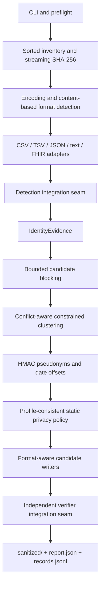

# Anaam

Anaam is an offline privacy firewall for the Secret Wards privacy-engineering challenge. It reads heterogeneous hospital exports, removes or transforms identity-bearing data, preserves clinical values and formats, links records conservatively, and writes the evaluator contract:

```text
output/
├── sanitized/
├── report.json
└── records.jsonl
```

## Current integration status

Omkar's processing and privacy engine is implemented in this repository: preflight security, inventory and hashing, format detection/adapters, format-aware serialization, identity blocking/scoring/clustering, HMAC pseudonyms, date shifting, static generalization, report/manifest generation, and local A1/A3/A4/A5/A6/A7 attack tools.

The repository currently routes detection through `src/detection/api.py`, which delegates to `src/detection/stub_detector.py` as a temporary integration seam. It only catches a small set of direct identifiers. Danish's clinical shield, multilingual PII detection, hidden-channel detector, and independent release verifier must replace that stub before submission. Current practice leak and linking results are therefore not final submission claims.

## Requirements

- Python 3.10 or newer
- No runtime network access
- `RAKSHA_SECRET` set to a non-empty release secret
- No external Python packages are currently required

## Run

PowerShell:

```powershell
$env:RAKSHA_SECRET = "practice"
python main.py --input dev\input --output my_output
python validate_output.py --input dev\input --output my_output
python check_dev.py --output my_output
```

Linux/macOS:

```bash
RAKSHA_SECRET=practice python main.py --input dev/input --output my_output
python validate_output.py --input dev/input --output my_output
python check_dev.py --output my_output
```

The output directory must be empty or absent. Anaam never modifies the input tree.

## Architecture



### Shared contracts

`src/core/interfaces.py` contains the frozen contracts used by both halves of Anaam:

- `FileEnvelope`, `RecordEnvelope`, `FieldNode`
- `SpanCandidate`, `ResolvedSpan`
- `IdentityEvidence`, `ScopedIdentifier`, `ClusterAssignment`
- `FieldTransformation`, `TransformPlan`, `VerificationResult`

Raw identity evidence stays in memory and is never logged or written to the release. The live pipeline creates one `TransformPlan` per record; pseudonym, date offset, generalized-field edits, spans, and terminal status therefore share one integration contract.

## Ingestion and formats

- Input traversal is sorted by POSIX-style relative path for cross-platform determinism.
- Every file is hashed with streaming SHA-256; duplicate paths remain separate inventory entries.
- UTF-8, UTF-8 BOM, UTF-16 LE/BE, BOM-less UTF-16 with strong endian evidence, and cp1252 are supported.
- Embedded UTF-16 BOMs, malformed JSON, extreme nesting, empty files, and unsupported extensions fail closed.
- Content sniffing recognizes JSON hidden behind a `.csv` extension while preserving the original output path.
- Supported release formats are CSV, TSV, JSON, plain text, and single-patient FHIR R4 document Bundles.
- Unsupported XML, PDF, JPG, and multi-patient FHIR Bundles are quarantined rather than copied raw.

## Identity resolution

Candidate generation runs deterministic passes for:

1. national identifiers;
2. hospital-scoped MRN/UHID identifiers;
3. phone numbers;
4. canonical name plus DOB;
5. canonical name plus relative;
6. cross-script/upstream name variants plus location;
7. phonetic residual candidates.

High-frequency weak blocks are capped and skipped instead of creating quadratic work or unsafe merges. Strong-ID blocks use deterministic star expansion when large.

Pair scoring applies the published rule: link on a shared strong identifier, or an exact canonical name plus a supporting clue. Contradictory national/scoped identifiers are hard conflicts. Gender, age, location, and relative mismatches are recorded as soft conflicts. `PROBABLE` edges may only join singleton clusters, so weak evidence cannot propagate through an A-B-C bridge. Before every merge, all cross-cluster evidence is checked directly for hard conflicts, even if a pair never shared a blocking key.

Abstention is intentional: an unresolved record receives `patient: null` rather than a risky merge.

## Pseudonyms

A linked cluster receives:

```text
fingerprint = SHA-256(sorted unique content anchors)
digest      = HMAC-SHA256(pseudonym_key, "patient-v1|" + fingerprint)
pseudonym   = "PSN-" + CrockfordBase32(digest)[:16]
```

Purpose-separated subkeys are derived from `RAKSHA_SECRET` for pseudonyms, date shifts, filename mapping, and optional temporary encryption. Exact duplicate files have distinct internal execution IDs but collapse to one content anchor for release identity, so adding a duplicate cannot change an existing pseudonym. Prefix collisions are detected and deterministically extended.

## Date shifting

- Every linked cluster receives one non-zero HMAC-derived offset.
- Unlinked records derive deterministic offsets from duplicate-insensitive content anchors.
- DD/MM/YYYY, DD/MM/YY, header-declared MM/DD/YYYY or MM/DD/YY, ISO dates, and FHIR date-times preserve their original syntax.
- CSV rows, JSON records, free text, and FHIR resources use per-record/patient offsets.
- A date mentioned inside ordinary free text -- a CSV notes cell, an unrecognized JSON string value, or FHIR narrative prose -- is shifted the same way a whole free-text document is, not only dates in a recognized date column/key.
- Admission/discharge intervals and cross-event ordering remain unchanged.
- A different release secret changes offsets.

## Static privacy policy

`config/policy.yaml` controls:

- five-year age bands;
- maximum date-shift range;
- minimum location group size.

CSV/TSV rows and JSON records (flat or nested, e.g. a registration record's `address.village`/`address.pin`) use one compatible plan per profile. Exact duplicate files do not inflate group counts. Location policy escalates from tehsil to district and then suppresses village, PIN, tehsil, and district when even district-level release is too rare. Generalized records are marked in `records.jsonl` and counted in `report.json`.

The CSV header-role table and the JSON key-role table share one lookup (`core.header_roles.role_for_header`), so a renamed column and a renamed JSON key are recognized identically. Full field classification for genuinely unseen labels is part of the pending detector integration; this table is a conservative, exact-match fallback, not a classifier.

## FHIR handling

For single-patient R4 document Bundles Anaam:

- assigns the pseudonymous `Patient.id`;
- removes patient identifier, name, telecom, address, birth date, contact, photo, and link fields;
- removes `meta.source` values that may contain source MRNs/paths;
- rewrites patient references at any nesting depth;
- preserves opaque `urn:uuid` full URLs and resolvability;
- sanitizes indexed narrative text;
- shifts all recognized dates with one patient offset.

Bundles with zero or multiple Patient resources fail closed until per-patient Bundle partitioning is implemented.

## Path and filename privacy

Filename and directory components containing phone-number or scoped hospital-ID shapes are replaced by secret-keyed HMAC names while preserving file extensions. `report.json` identifies input files only by SHA-256 and declares the new output path; it never contains original filenames.

Name-only filename detection will be supplied by the hidden-channel detector during Danish's integration.

## Security design

- Missing/empty secrets fail before the output directory is created.
- Input/output overlap and unsafe escaping symlinks are rejected.
- Non-empty output directories are rejected to prevent stale-release mixing.
- Python socket connect, UDP send, and DNS resolution are blocked in-process; the evaluator also denies network access externally.
- Errors exposed to stdout/stderr contain safe reason codes only.
- The secret and derived keys are never logged or serialized.
- Unsupported or malformed inputs are quarantined, never copied into `sanitized/`.
- A single file's rendering failure (a bad header, an unexpected structure, any unhandled exception) quarantines only that file. Anything it already queued in `records.jsonl`/`report.json` is rolled back first, so the rest of the release still completes instead of the whole run crashing.
- All candidate bytes remain in memory until every file has rendered and passed CSV/JSON/FHIR structural checks; the complete `sanitized/` tree is then published by directory rename.
- `report.json` and `records.jsonl` use atomic temporary-file replacement, and temporary files are removed on failure.
- Output filenames, reports, manifests, stdout, and stderr avoid raw input paths.

## Tests

A standard-library-only `unittest` suite covers the highest-risk logic: date-shift syntax/interval preservation and keying, identity clustering's hard-conflict and transitive-bridge guards, pseudonym order/duplicate insensitivity and secret-sensitivity, the shared header-role table, JSON/FHIR generalization and free-text date shifting, FHIR narrative indexing, and atomic candidate publication/structural validation.

```powershell
python -m unittest discover -s tests
```

No pytest or other third-party test runner is required.

## Local attack lab

These tools read practice-only attacker/truth files and are never imported by `main.py`:

```powershell
python tools\attack_lab\run_attacks.py --output my_output --attacker dev\attacker
python tools\attack_lab\run_inversion.py --output my_output --truth dev\truth\truth.json
python tools\attack_lab\run_cross_release.py --release-a release_a --release-b release_b
```

Implemented local measurements:

- A1 direct exposure, including output filenames;
- A3 record linkage with skip-empty filtering;
- A4 maximal profile aggregation through pseudonyms and surviving references;
- A5 known-facts matching and high-confidence global-shift recovery;
- A6 unkeyed pseudonym-transform inversion;
- A7 source-keyed cross-release pseudonym/date stability.

They are directional local measurements, not official scores.

## Determinism and measured pipeline checks

On the bundled 200-file practice dataset, Omkar's pipeline currently:

- prints `CONTRACT OK`;
- accounts for all 200 input files;
- sanitizes 193 and quarantines 7 malformed/unsupported files;
- preserves 4,855/4,855 medical probes when outputs are resolved using actual input hashes;
- produces byte-identical `sanitized/` and `records.jsonl` across same-secret runs;
- compares all 817 records across different-secret releases with zero unmatched records and zero stable pseudonyms;
- leaves 1.6% coincidentally stable date pairs in the local A7 approximation;
- copies zero unsupported files raw;
- passes `python -m unittest discover -s tests` (76 unit tests, standard library only).

These are development measurements, not final team claims. Detection, linking, independent verification, held-out testing, and the two-page project brief remain before submission.

## Known limitations before team integration

- The temporary detector does not remove most patient/relative names, MRNs, addresses, masked Aadhaar values, multilingual names, Base64 identity data, PII-bearing JSON keys/headers, or name-only filenames.
- Identity linkage remains empty until real `IdentityEvidence` arrives from Danish's detector modules.
- The independent release verifier is not wired into candidate publication yet.
- Record-level rare-condition suppression depends on clinical risk flags from Danish's side.
- Multi-patient FHIR Bundles are quarantined rather than partitioned.
- FHIR resources other than `Patient` (e.g. a diagnosis/age-equivalent value on another resource type) are not passed through O10's age/village/PIN generalization; only CSV and JSON records are.
- The Project Brief PDF has not been added.

## Submission configuration

`raksha.toml` is at the repository root:

```toml
[submission]
name  = "anaam"
setup = "pip install -r requirements.txt"
run   = "python main.py --input {input} --output {output}"
```
