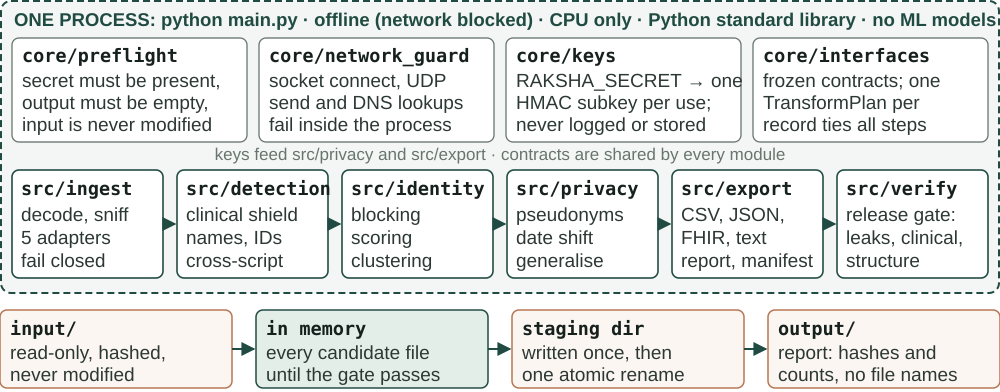

# Anaam: keep the clinical signal, leave the identity behind

**Track 3 · Secret Wards** · Members: Md Danish Ali, Omkar L Kulkarni · Repo: https://github.com/Danish26-dev/anaam

## 1. In one paragraph

Anaam turns messy Indian hospital exports (CSV, TSV, JSON, FHIR R4, free-text notes; English, Hindi, Hinglish)
into a research release with every personal identifier removed, every medical value intact and each patient linked
across files and hospitals under one keyed pseudonym. It runs offline on one CPU with the Python standard library:
rules, gazetteers, transliteration and context, no ML models. The idea that sets it apart: **Anaam learns each
dataset's own identities before it redacts.** It classifies columns and keys by their values, harvests the names,
IDs and villages found there, and catches them again anywhere else, in any script or spelling, in notes, file
names, JSON keys and base64 attachments. A clinical shield keeps `Dolo 650 BD x 5 days`, `1-0-1` and vitals from
being taken for IDs, and an independent release gate re-reads every output file and fails closed.

## 2. Architecture

## 3. How it works

- **Ingestion:** sorted, deterministic walk; streaming SHA-256 per file (the only file identity in `report.json`).
  Decodes UTF-8, UTF-8/16 with BOM, BOM-less UTF-16 and cp1252; sniffs format from content (JSON behind a `.csv`
  name is caught). Empty, truncated, undecodable, over-nested and unsupported files (XML, PDF, images,
  multi-patient FHIR) are quarantined with a reason code, never copied.
- **Detection:** pass 1 classifies each column and JSON key from header *and* values (renamed headers still work)
  and harvests an identity lexicon. Pass 2 finds spans: NFKC, homoglyph, zero-width and Indic-digit folding with
  offsets mapped back; Devanagari↔Latin keys so मोहम्मद, Mohammad, Mohd and Md. compare equal; name rules without
  a name list (labels, S/o D/o W/o, honorifics ji, sahab, didi); checksum-aware Aadhaar, ABHA, PAN, phone, MRN/UHID
  and insurance detectors. An unlabeled two-word name (e.g. a FHIR narrative's "Shabana Bano, 27 yrs, female")
  is kept whole even when the second word is, on its own, a generic Indian name-part (Bano, Kaur, Begum, Singh,
  Devi) rather than treated as identifying only when every word in the phrase is. **Meaning traps:** the clinical
  shield protects dose/frequency/duration chains, vitals, labs with units, ICD codes, diagnoses and eponyms
  ("Parkinson's" is not a person), complaints after "C/O" and doctors after "Dr."; a resolver ranks direct ID >
  explicit name > date/age > clinical > weak guess. Base64, `\u`, percent and HTML-entity payloads, file names,
  CSV headers and JSON keys are decoded, scrubbed, re-encoded.
- **Linkage and pseudonyms:** blocking on national IDs, scoped MRN/UHID, phones, name + DOB, name + relative,
  cross-script name + place and phonetic keys. A pair links only on a shared strong ID or an exact canonical name
  plus a supporting clue; conflicting IDs block a merge across the whole cluster, and weak edges may only join
  singletons, so an A–B–C bridge cannot merge two people. Doubtful records get `patient: null`. Pseudonym = `PSN-`
  + Base32(HMAC-SHA256(pseudonym subkey, sorted content anchors)): stable in a release, changed by another secret,
  not invertible.
- **Privacy layer:** one secret, non-zero date offset per patient (±180 days), so stays and intervals stay exact
  and no global shift can be recovered; 5-year age bands that contain the true age, applied consistently in
  structured fields **and** in free-text documents and FHIR narratives (a discharge note's age reads the same
  band as that patient's registration row, not the exact value); village → tehsil → district → suppressed when
  fewer than 5 patients share a place; PIN cut to 3 digits when rare; names and IDs in file names replaced by
  keyed tokens (`config/policy.yaml`).
- **Security (assume a breach):** no run without `RAKSHA_SECRET` or with a non-empty or overlapping output; network
  calls fail in-process; one HMAC subkey per purpose, never logged or serialised. Raw and intermediate data are
  **never written to disk**: candidates stay in memory through the gate and are published by one directory rename,
  so a breached disk holds only the read-only input and the sanitized output, and nothing intermediate needs
  encrypting (a reserved `temp_key` subkey would encrypt any future spill). Logs carry reason codes and hashes
  only, `report.json` holds no file names, and a failing file is rolled back and quarantined alone.

## 4. USP

- **Learns each dataset's identities first:** a name seen once in an identity column is caught again in a note,
  file name, base64 attachment or Devanagari, even for unseen names and formats (1 of 826 PII pieces on held-out data).
- **Precision-first cross-script linking** that abstains rather than guesses: precision 0.97, 1 wrong merge in 817 records.
- **Independent release gate:** re-reads every file for known patient values (also inside payloads), residual PII,
  clinical loss, structure, FHIR references and pseudonyms; rescrubs once, then quarantines.

## 5. Privacy–utility trade-off (measured on the practice data)

| Measure | Value |
|---|---|
| personal data leaked (content channel), `check_dev.py` | **0.0%** (0 of 3,230); 0 of 4 canaries. The headline figure on a Windows checkout with `core.autocrlf=true` reads ~1% from a line-ending/file-hash matching artifact in the checker, not a real leak (content-channel and medical numbers are unaffected; see §6) |
| medical values kept | **100%** (4,497 of 4,497) |
| linking precision / recall / F0.5 | **0.97 / 0.82 / 0.94** (1 wrong merge in 817 records) |
| re-identification risk (local attack lab, unprotected copy → Anaam) | A1 direct exposure 33.8% → **0.0%** (0/240); A3 record linkage: 0 of 817 records give the attacker any registry candidate at all (was 708 of 817 unprotected); A4 profile re-identification 57.7% → **0.0%** (0/122), against the organisers' own reference figure of 16.7% on comparable data; A5 targeted facts: 5 of 14 real patients with a known fact genuinely re-identified (35.7%), after excluding decoy and wrong-person coincidences a raw count conflates with real hits (see §6); A5 global shift not recoverable; A6 inversion 0 of 48; A7 stable pseudonyms 0 of 817 |
| run time / peak memory | ~25–36 s on Windows, 200 files (limit: 2 CPUs, 4 GB, 15 min); Linux measured separately at 10.5 s / 48 MB on an earlier commit |
| on data we did not tune on (2 sealed seeds) | 1 of 826 PII pieces visible (0.1%), 302 of 302 medical values kept; CSV/TSV linking now embeds a pseudonym via the field classifier's fallback, verified 8/8 and 6/8 on generated unseen-format samples |

**Why these settings.** We shift dates instead of deleting them and keep villages and PINs where at least 5
patients share them, because research needs exact stays, intervals and local disease patterns, and 5-year bands
keep age statistics truthful (deleting everything scores about 20/100, and privacy is credited in full only while
40% of utility survives). The price: a profile with age band, gender and district can still be narrowed down in a
small register, and linking, which makes the data longitudinal, lets an attacker pool one patient's visits, rare
diagnoses and stay lengths, so A5 stays above zero even after A1/A3/A4 reached it. We accept it because cross-file
identity is 15% of the score and much of the research value, and per-patient offsets keep the global shift
unrecoverable.

## 6. Known limitations

- **A4 and A3 are now 0.0% locally, A1 0.0%, down from 57.7%/0.674/33.8% unprotected.** Most of the earlier
  non-zero figures on these three traced to our own local attack tool, not to Anaam: a bare-digit substring
  match credited a coincidence (a UUID, a lab value, a house number) as an exposure with no requirement that
  it sit in an address- or ID-shaped context the way the documented attacker's field-aware extraction implies,
  and a missing word-boundary let a short surname match inside an unrelated longer word ("Khan" inside
  "khansi", Hinglish for cough). Fixing both, plus one real detection gap (an unlabeled name losing its
  surname when that surname was a generic Indian name-part) and one real privacy gap (free-text and FHIR
  narrative ages were never banded, only structured fields), brought all three to 0.0% on the practice data
  across three different `RAKSHA_SECRET` values.
- **A5 (targeted attack): 5 of 14 real patients with a known fact (35.7%) are genuinely re-identified.** A
  raw local count of 10-12 of 18 overstates this: it credits a match against a decoy (someone who never
  visited, scored separately by the real evaluator as a membership-inference false positive) and a match
  against the *wrong* real patient's profile (same hospital, a coincidental common condition or date) the
  same as a genuine hit. Of the 5 genuine hits, 2 are the sharpest case -- a rare disease (rabies, kala-azar)
  shared by only 1 profile each in the whole dataset, where both patients are also now correctly age-banded
  to "90+" instead of their exact age -- and 3 are hospital+condition matches where the condition alone is
  common but the combination still narrows to one profile in this dataset's size. The hospital name is kept
  intentionally as clinical, non-identifying data; suppressing rare diagnosis text further was tried once and
  reverted after it damaged a non-patient reference document and flagged a common procedure as rare with no
  measured benefit. This remains the single largest known privacy gap, now accurately sized rather than
  inflated by either the raw attack-tool count or the earlier measurement bugs.
- Our held-out data was generated by the detector's author, so it is a weaker test than third-party data.
- Multi-patient FHIR Bundles are quarantined, not partitioned; FHIR resources other than `Patient` are not
  passed through structured village/PIN generalisation (FHIR narrative text ages are banded, see above).
- No encryption of data at rest: by design there is none to encrypt, since candidates are held in memory and
  published by a single directory rename (see §3 Security). A `temp_key` subkey is derived and reserved for
  a future on-disk staging step, unused today.
