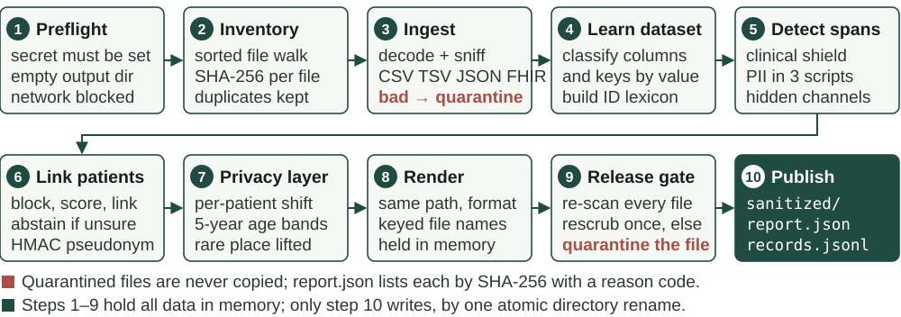

# Anaam: keep the clinical signal, leave the identity behind

**Track 3 · Secret Wards** · Members: Md Danish Ali, Omkar L Kulkarni · Repo: https://github.com/Danish26-dev/anaam

## 1. In one paragraph

Anaam turns messy Indian hospital exports (CSV, TSV, JSON, FHIR R4, free-text notes; English, Hindi, Hinglish)
into a research release with every personal identifier removed, every medical value intact and each patient linked
across files and hospitals under one keyed pseudonym. It runs offline on one CPU with the Python standard library:
rules, gazetteers, transliteration and context, no ML models. The idea that sets it apart: **Anaam learns each
dataset's own identities before it redacts.** It classifies columns and keys by their values, harvests the names,
IDs and villages found there, and catches them again anywhere else, in any script or spelling, in notes, file
names, JSON keys and base64 attachments. A clinical shield keeps `Dolo 650 BD x 5 days`, `1-0-1` and vitals from
being taken for IDs, and an independent release gate re-reads every output file and fails closed.

## 2. Architecture

## 3. How it works

- **Ingestion:** sorted, deterministic walk; streaming SHA-256 per file (the only file identity in `report.json`).
  Decodes UTF-8, UTF-8/16 with BOM, BOM-less UTF-16 and cp1252; sniffs format from content (JSON behind a `.csv`
  name is caught). Empty, truncated, undecodable, over-nested and unsupported files (XML, PDF, images,
  multi-patient FHIR) are quarantined with a reason code, never copied.
- **Detection:** pass 1 classifies each column and JSON key from header *and* values (renamed headers still work)
  and harvests an identity lexicon. Pass 2 finds spans: NFKC, homoglyph, zero-width and Indic-digit folding with
  offsets mapped back; Devanagari↔Latin keys so मोहम्मद, Mohammad, Mohd and Md. compare equal; name rules without
  a name list (labels, S/o D/o W/o, honorifics ji, sahab, didi); checksum-aware Aadhaar, ABHA, PAN, phone, MRN/UHID
  and insurance detectors. **Meaning traps:** the clinical shield protects dose/frequency/duration chains, vitals,
  labs with units, ICD codes, diagnoses and eponyms ("Parkinson's" is not a person), complaints after "C/O" and
  doctors after "Dr."; a resolver ranks direct ID > explicit name > date/age > clinical > weak guess. Base64, `\u`,
  percent and HTML-entity payloads, file names, CSV headers and JSON keys are decoded, scrubbed, re-encoded.
- **Linkage and pseudonyms:** blocking on national IDs, scoped MRN/UHID, phones, name + DOB, name + relative,
  cross-script name + place and phonetic keys. A pair links only on a shared strong ID or an exact canonical name
  plus a supporting clue; conflicting IDs block a merge across the whole cluster, and weak edges may only join
  singletons, so an A–B–C bridge cannot merge two people. Doubtful records get `patient: null`. Pseudonym = `PSN-`
  + Base32(HMAC-SHA256(pseudonym subkey, sorted content anchors)): stable in a release, changed by another secret,
  not invertible.
- **Privacy layer:** one secret, non-zero date offset per patient (±180 days), so stays and intervals stay exact
  and no global shift can be recovered; 5-year age bands that contain the true age (also in `39/M` cells);
  village → tehsil → district → suppressed when fewer than 5 patients share a place; PIN cut to 3 digits when rare;
  names and IDs in file names replaced by keyed tokens (`config/policy.yaml`).
- **Security (assume a breach):** no run without `RAKSHA_SECRET` or with a non-empty or overlapping output; network
  calls fail in-process; one HMAC subkey per purpose, never logged or serialised. Raw and intermediate data are
  **never written to disk**: candidates stay in memory through the gate and are published by one directory rename,
  so a breached disk holds only the read-only input and the sanitized output, and nothing intermediate needs
  encrypting (a reserved `temp_key` subkey would encrypt any future spill). Logs carry reason codes and hashes
  only, `report.json` holds no file names, and a failing file is rolled back and quarantined alone.

## 4. USP

- **Learns each dataset's identities first:** a name seen once in an identity column is caught again in a note,
  file name, base64 attachment or Devanagari, even for unseen names and formats (1 of 826 PII pieces on held-out data).
- **Precision-first cross-script linking** that abstains rather than guesses: precision 0.97, 1 wrong merge in 817 records.
- **Independent release gate:** re-reads every file for known patient values (also inside payloads), residual PII,
  clinical loss, structure, FHIR references and pseudonyms; rescrubs once, then quarantines.

## 5. Privacy–utility trade-off (measured on the practice data)

| Measure | Value |
|---|---|
| personal data leaked (overall / Hindi / Hinglish) | **0.0% / 0.0% / 0.0%**: 0 of 3,230 (`check_dev.py`), 0 in file names, headers, keys, metadata or base64; 0 of 4 canaries |
| medical values kept | **100%** (4,855 of 4,855) |
| linking precision / recall / F0.5 | **0.97 / 0.90 / 0.95** (1 wrong merge; 746 of 817 records linked) |
| re-identification risk (our estimate) | 44 of 123 released profiles still show age band + gender + district; **18 (15% of all profiles) fit exactly one person** in the 240-person practice register, 20 fit 2–4. Local attack lab, unprotected copy → Anaam: A4 profile re-identification 43.0% → **15.5%** (organisers' reference 16.7%); A5 targeted facts 27.8% → 61.1%; A6 inversion 0 of 48; A7 stable pseudonyms 0 of 817, stable dates 2.4% |
| run time / peak memory | **10.5 s / 48 MB** on Linux, one CPU, 200 files (limit: 2 CPUs, 4 GB, 15 min) |
| on data we did not tune on | two sealed chaos seeds (unseen names, labels, ID shapes, date formats), run once: 1 of 826 PII pieces visible (0.1%), 0 of 6 canaries, 302 of 302 medical values, CONTRACT OK; records with a pseudonym: CSV 16/16, TSV 12/16, JSON 24/28, text 52/72 (linking accuracy unscorable: no patient labels) |

**Why these settings.** We shift dates instead of deleting them and keep villages and PINs where at least 5
patients share them, because research needs exact stays, intervals and local disease patterns, and 5-year bands
keep age statistics truthful (deleting everything scores about 20/100, and privacy is credited in full only while
40% of utility survives). The price: a profile with age band, gender and district can still be narrowed down in a
small register, and linking, which makes the data longitudinal, lets an attacker pool one patient's visits, rare
diagnoses and stay lengths, so A5 is higher than on an unlinked copy. We accept it because cross-file identity is
15% of the score and much of the research value, and per-patient offsets keep the global shift unrecoverable.

## 6. Known limitations

- **Targeted attack (A5):** 11 of 18 known-fact targets matched locally. Next: suppress or coarsen rare diagnoses
  and stay lengths only where at most 3 profiles share them (k-anonymity on the rare tail), kept only if A4/A5,
  medical probes and linking all hold. A first rare-diagnosis pass flagged common terms and was reverted.
- **Our attack lab only approximates the organisers' attacker:** it over-counted bare house numbers (fixed) and
  still matches Aadhaar last-4 digits inside dates, so it reports A1 4.6% while `check_dev.py` finds no visible ID.
- Multi-patient FHIR bundles are quarantined, not split; FHIR resources other than `Patient` are not generalised.
- Our held-out data was generated by our own team, a weaker test than third-party data.
